# TileSmith

**[TLDR I just want to download it](#download)**

Pre production software for LED walls. Engineering specs, cable labels, pixel maps and test patterns with some fun animation for vidiots. Yes it is vibe coded. I was on tour and I kept seeing similar, obviously vibe coded software, that had a cute animation of a tech building a led wall. Everyone was charging an annual fee, distributing .exe files that couldn't pass an antivirus scan and wouldn't share source code, or wanting an email address and other info in exchange for their app. So I decided to do it myself and release the project with an open source license.

**At a glance**

- **What it does:** lays out LED walls on a canvas and gives you pixel maps, test patterns, processor ports and data paths, power circuits and distros, cable lengths, rigging, labels, a pull sheet and a show binder, plus live NDI®, Spout and Syphon output and an animated crew that builds the wall.
- **Runs on:** Windows, Mac and Linux (Electron desktop app), Android and iOS (the same page in a native wrapper), or any modern browser for everything except the live outputs and video export.
- **Current version:** 3.10. Only the Windows build has been used on real shows; the others are experimental.
- **Licence:** GPL-3.0-or-later for the code; the animated technician artwork and the name are all rights reserved (see [Licence](#licence)).
- **For reviewers:** [docs/REVIEW-GUIDE.md](docs/REVIEW-GUIDE.md) explains how the app is built, how to run the tests and what is known to be weak; [docs/CODE-REVIEW.md](docs/CODE-REVIEW.md) has the code review findings. [docs/MEMORY.md](docs/MEMORY.md) has measured memory use.

**Contents:** [Videos](#videos) · [Screenshots](#screenshots) · [How to: own Socapex cable per wall](#how-to-give-each-led-wall-its-own-socapex-cable) · [How to: draw power circuits](#how-to-draw-power-circuits-by-hand) · [What's new](#whats-new-in-39-and-310) · [How it works](#how-it-works) · [Memory use](#memory-use) · [Download](#download) · [Software to install](#software-to-install-before-you-use-a-downloaded-build) · [Building](#building) · [Licence](#licence)

## Videos

> **Note:** these videos show a very early version of TileSmith. The app has changed a lot since they were filmed.

<table>
<tr>
<td width="33%" valign="top">

https://github.com/user-attachments/assets/ad490931-0c5d-47d6-92ca-d4c2faeee1d6

<b>On site, building a real wall</b> The build animation running on an LED wall in an arena while the crew builds it, tile by tile.

</td>
<td width="33%" valign="top">

https://github.com/user-attachments/assets/ccb46ffc-e185-4ef4-a353-455af979b058

<b>LED build animation</b> A tech carries tiles into place and the wall fills in, row by row, on a laptop.

</td>
<td width="33%" valign="top">

https://github.com/user-attachments/assets/3fe2f407-80e1-4f42-a2f5-a2593f6d69d9

<b>Test pattern in an arena</b> A TileSmith test pattern on the side screens of an arena during setup.

</td>
</tr>
</table>

## Screenshots

**Data and power wiring.** Two walls on a Brompton Tessera S8, with data paths (P# to R#) and power circuits drawn on the tiles, and the engineering figures on the right.

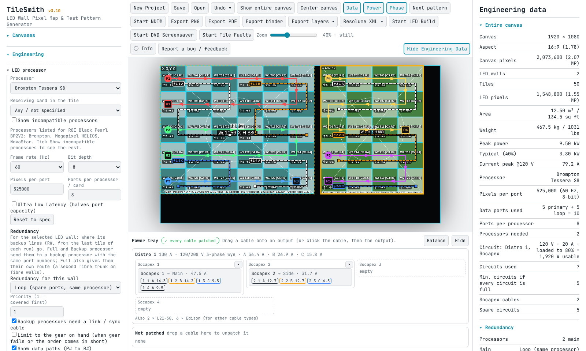

**DVD screensaver over SMPTE bars.** The TileSmith logo bounces around each wall on top of the SMPTEbars test pattern.

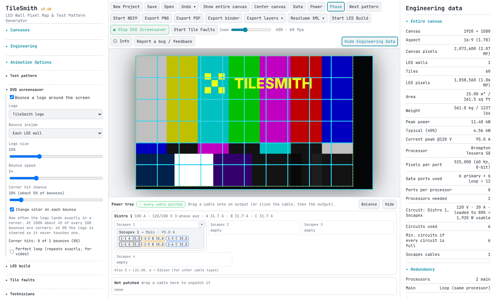

**LED build animation.** The wall is half built and a tech is carrying the next tile into place on the third row.

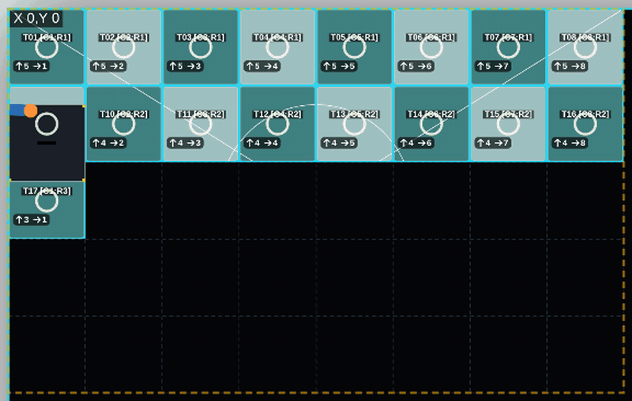

The screenshots are made from the app itself with `manual-src/make_readme_shots.py`.

## How to: give each LED wall its own Socapex cable

Walls that are too far apart to share a power run each get their own cable. In this screenshot, Main uses Socapex 1 and 2, IMAG Left uses Socapex 3, and the legs a wall does not need show as dashed *spare* chips. The numbers match the steps below.

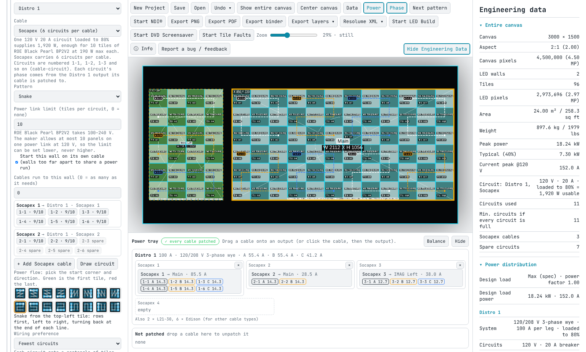

1. Open **Engineering › Power** and click **+ Add distro** (or **+ Add house power**). Supply, Load and This wall only appear once there is a supply.
2. Select a wall in **Canvases › LED walls**, open **Power › This wall** and pick a **Pattern**, or draw circuits by hand with **Draw circuit**.
3. Make sure **Start this wall on its own cable (walls too far apart to share a power run)** is ticked (**3** in the screenshot). It sits under Power link limit, so you may need to scroll the left panel down to see it. New walls have it ticked.
4. Select the next wall and do the same. The power tray under the viewport shows each cable, the wall it runs to and the distro output it is patched to (**4**).

**Spare legs.** A wall uses only the circuits it needs, and the rest of its cable stays spare (**S**). To leave more legs free, keep **Power link limit** at 0 or the maker's count (a lower limit spreads the tiles over more legs). You can also raise **Cables run to this wall** to run an extra, empty cable, or draw the circuits yourself and leave the chips you want spare unused. There is no setting yet that reserves a number of legs on every cable.

## How to: draw power circuits by hand

When an automatic pattern does not match how the crew will cable the wall, draw the circuits yourself. The numbers match the screenshot.

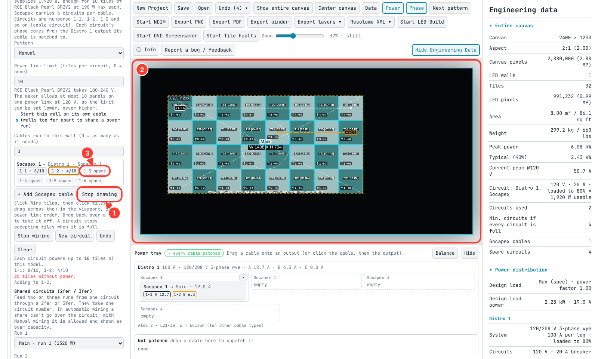

1. With a supply added (see the steps above), select the wall and open **Engineering › Power › This wall**. Click **Draw circuit** under the wall's cable card. The wall switches to Manual power wiring, keeping any circuits its pattern had, and the button now reads **Stop drawing**.
2. Click tiles in the viewport in power-link order, or press on a tile and drag across the others. Each circuit's chip counts its tiles against the limit (here **1-1 · 8/10**), and a full circuit refuses more tiles.
3. Click a dashed **spare** chip to start the next circuit on that leg, or click an existing chip to add tiles to that circuit. Click **Stop drawing** when you are done.

**+ Add Socapex cable** runs one more cable to the wall. The power tray under the viewport shows which distro output each cable is patched to.

## What's new in 3.9 and 3.10

<table>
<tr>
<td width="50%" valign="top">

<b>Power cables per wall.</b> Each LED wall starts on its own cable, so walls too far apart to share a power run never end up on the same Socapex, and the legs a wall does not use show as spare. Each cable is a card with a chip per circuit, and <b>Draw circuit</b> lets you draw circuits by hand.

</td>
<td width="50%" valign="top">

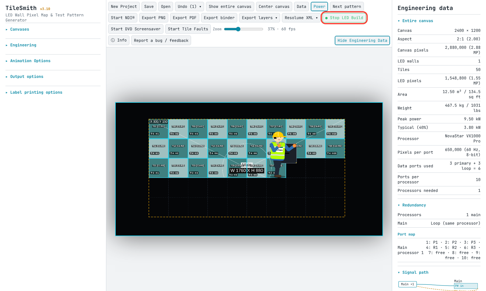

<b>Effect buttons light up.</b> Start LED Build, Start DVD Screensaver and Start Tile Faults turn green and read Stop while their effect runs. The LED build stays on or off across a restart, and a looped build no longer restarts itself after you stop it.

</td>
</tr>
</table>

Also new in 3.9 and 3.10:

- **Power settings in the order a power tech works.** Engineering › Power is now **Supply** (distros or house power, each with its own circuit voltage and breaker), **Load**, **This wall** (which supply and which cable feeds the selected wall) and **Show**. Older projects are converted when they open.
- **Maker power limits.** For 369 of the 402 built-in tile models TileSmith knows the input voltage range and how many panels the maker allows on one power link, from the makers' own sheets. Voltages a tile is not made for are greyed out and the power link limit can be lowered but not raised.
- **The distros set the rules.** Circuit voltage, cable type and breaker can only be what the distros supply; a breaker is capped at its connector's rating.
- **Walls never share power circuits.** A copied wall used to share its power wiring with the original, so drawing on one rewired the other. Fixed; an empty power tray now says *No cables yet*.
- **Update now works on Windows.** The installer is started by TileSmith's main process and waits for TileSmith to close before it installs, and it writes a log next to the download.

## What's new in 3.7 and 3.8

<table>
<tr>
<td width="50%" valign="top">

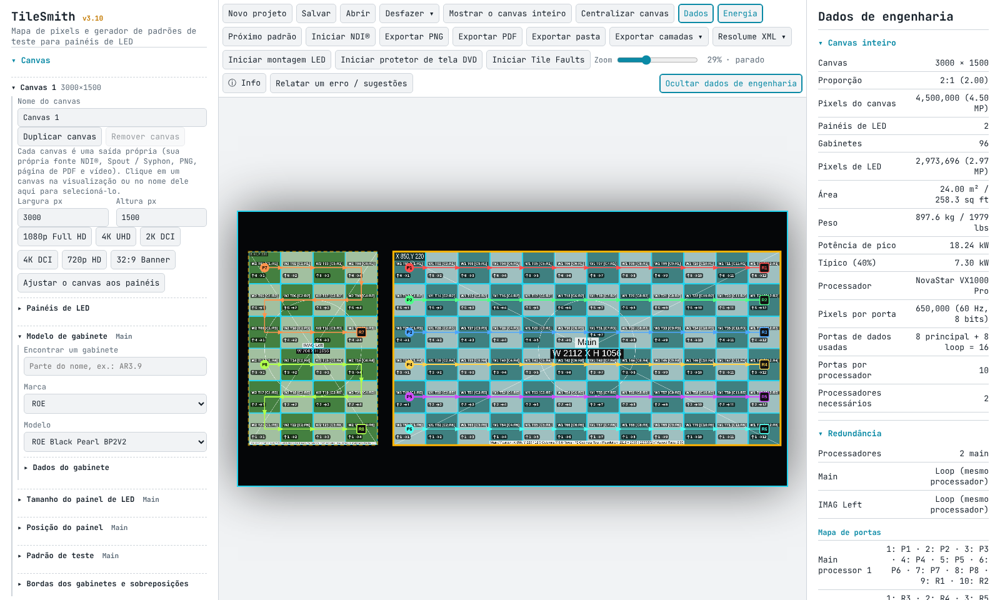

<b>Ten languages.</b> German, French, Italian, Dutch, Simplified Chinese, Japanese and Korean join English, Español and Português (Brasil). Pick one under ⓘ Info › Preferences; a first visit uses your browser's language.

</td>
<td width="50%" valign="top">

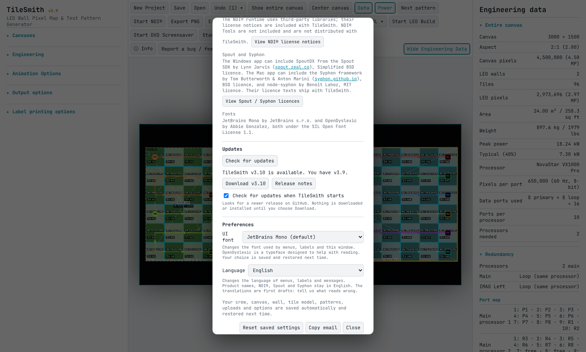

<b>Check for updates.</b> ⓘ Info › Updates asks GitHub for the newest release and opens the right download for your computer. The desktop and phone apps check by themselves once a day and show a small note when a new version is out.

</td>
</tr>
</table>

Also new in 3.7 and 3.8:

- **Windows and Mac installers.** Next to the portable and .dmg downloads there is now a Windows setup (Start menu, desktop shortcut, uninstaller) and a Mac .pkg. The Windows setup offers to fetch the NDI® Runtime and ffmpeg for you.
- **Add-ons.** ⓘ Info › Add-ons shows whether NDI® and ffmpeg are set up, installs NDI's own Runtime installer, and downloads ffmpeg into TileSmith's own folder.
- **More gear.** Aluvision Hi-LED 55 tiles (12 flat and curved models) and 13 more NovaStar processors, including the MCTRL4K, MCTRL R5, MX20, MX30 and VX600 Pro, all from the makers' spec sheets.
- **One sub menu at a time.** Opening a sub menu in the left panel closes the others in the same menu, with a short slide. Double-click a sub menu to keep the others open.
- **Tile faults.** Random mix no longer repeats the same fault start after start, and the panel names the faults on show.

## What's new in 3.6

<table>
<tr>
<td width="50%" valign="top">

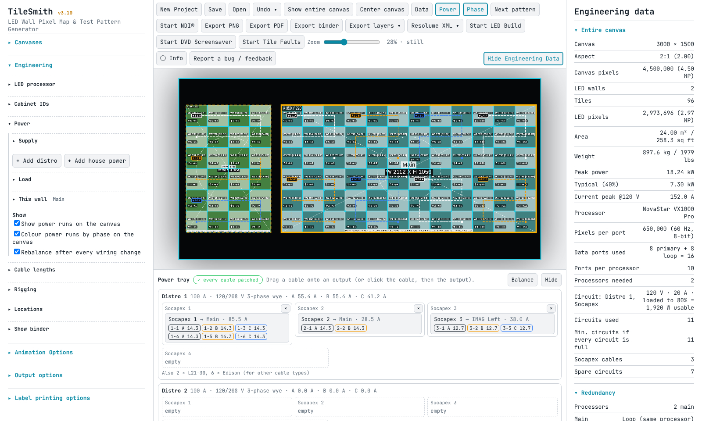

<b>Power distros and phase balance.</b> Add the distros the walls plug into, patch each cable to an output in the power tray, and see the amps on every leg, the neutral and the imbalance. Balance evens out the legs without changing the wiring; the Phase button colours each run by its phase.

</td>
<td width="50%" valign="top">

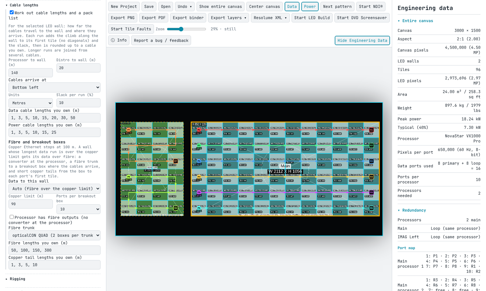

<b>Cable lengths, fibre and breakout boxes.</b> Set how far each wall is from the processor and the distro and which cable lengths you own. TileSmith works out every run and a cable pack list, and sends long data runs over fibre with converters, opticalCON trunks, breakout boxes and copper tails.

</td>
</tr>
<tr>
<td width="50%" valign="top">

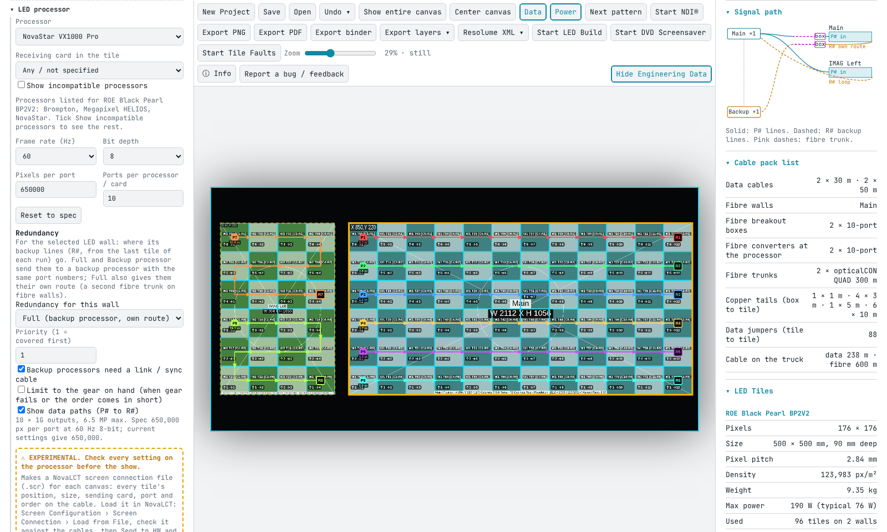

<b>Redundancy and the signal path.</b> Pick Full, Backup processor, Loop or Spare processor for each wall, limit the plan to the gear you actually have, and read the port map and a signal path diagram in Engineering.

</td>
<td width="50%" valign="top">

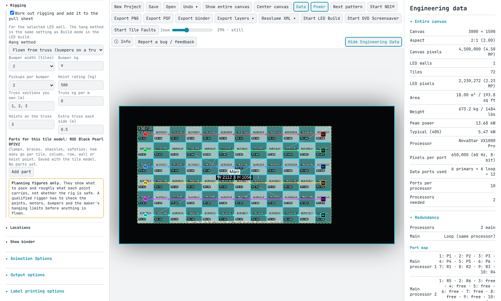

<b>Rigging.</b> Ground stack, flown from motors or flown from truss: bumpers, truss sections, ground bases, hoist points and the load on each hoist, with parts rules per tile model, all added to the pull sheet. Planning figures only.

</td>
</tr>
<tr>
<td width="50%" valign="top">

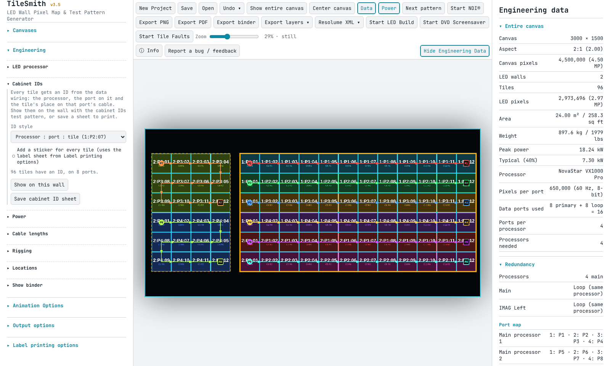

<b>Cabinet IDs.</b> Every tile gets an ID from the data wiring (processor : port : tile). Show them on the wall as a test pattern, or save a cabinet ID sheet with a sticker for each tile.

</td>
<td width="50%" valign="top">

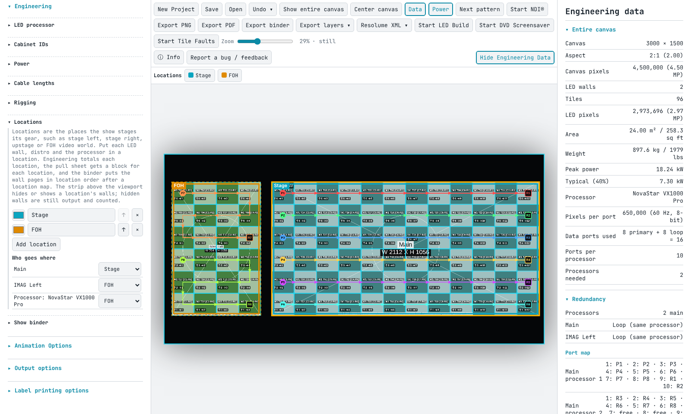

<b>Locations.</b> Stage your walls, processor and distros in locations such as Stage or FOH. Engineering totals each location, the viewport outlines them, and the pull sheet and binder are sorted by location.

</td>
</tr>
<tr>
<td width="50%" valign="top">

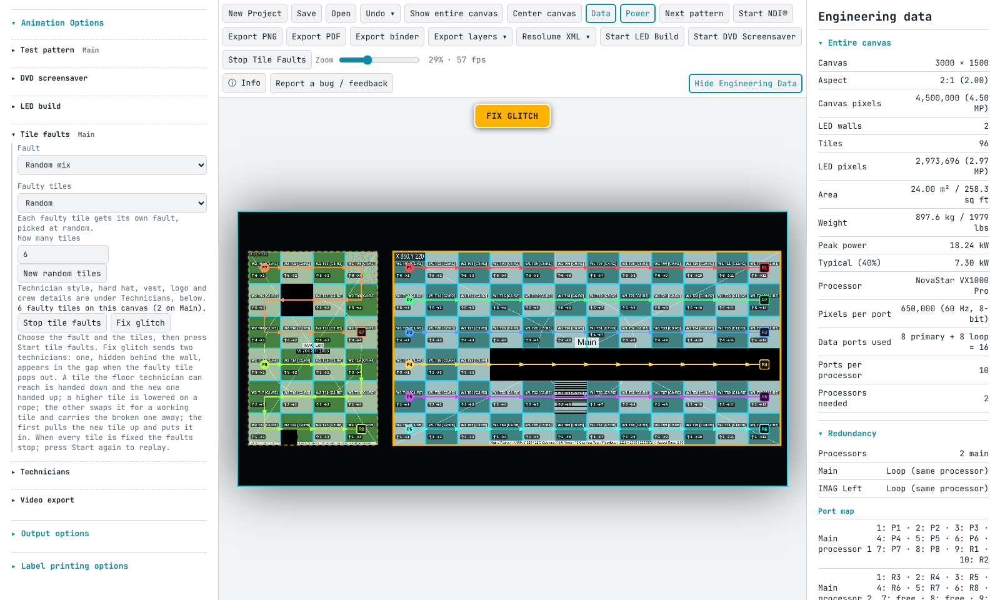

<b>Tile faults and Fix glitch.</b> Show twelve kinds of LED tile failure, from a dead tile to a tripped circuit, on the tiles you pick or at random. Fix glitch sends two technicians to swap each faulty tile.

</td>
<td width="50%" valign="top">

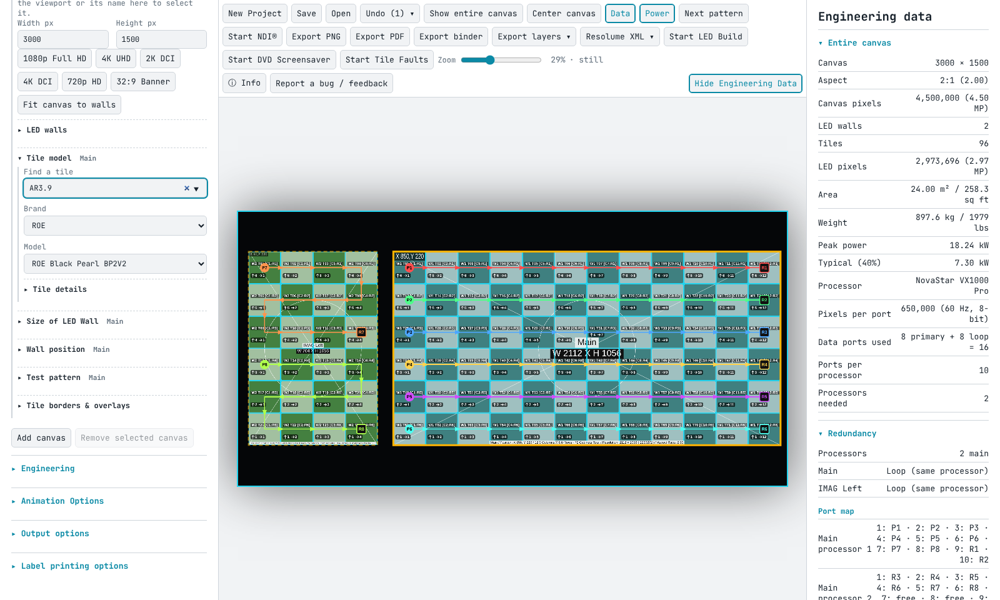

<b>209 more tile models.</b> INFiLED, AOTO, Gloshine and Absen tiles from the makers' spec sheets, grouped by series, with a Find a tile search box and the source sheet shown in Engineering.

</td>
</tr>
</table>

Also new in 3.6:

- **Export binder and pull sheet.** One PDF for the show folder: cover, contents, the canvas, a page per wall, cabinet IDs, a pull sheet with spares and Pulled / Loaded / Back boxes, the spec sheet and the cable labels.
- **Export layers.** Save the pixel map as a layered SVG or PSD (background, test pattern, tile grid, labels, data and power paths) to finish it in Illustrator or Photoshop.
- **Build modes.** Start the LED build from any corner, row by row or column by column, or hang the wall from motors or a truss, top row first.
- **Hand-drawn and Backlit crew.** Two new technician styles next to Classic: realistic workers drawn with ink lines, and a dark figure lit by the wall.
- **Power math fixes.** Power factor, design load (max, typical or measured) and processor port capacities checked against the makers' published figures.
- **17 Absen tiles** in the built-in tile list.
- **Español and Português (Brasil).** Pick the language under ⓘ Info › Preferences.

These screenshots are made from the app with `manual-src/make_readme_features.py`.

## How it works

The whole app is one web page, [`tilesmith-desktop/app/index.html`](tilesmith-desktop/app/index.html): HTML, CSS and plain JavaScript with no framework and no build step. Every platform runs that same file.

- The **desktop app** is that page in an [Electron](https://www.electronjs.org/) window. In the desktop app the page can also reach the computer directly: it sends frames to the NDI® runtime and to Spout (Windows) through [koffi](https://koffi.dev/), to Syphon (Mac) through node-syphon, and pipes frames into ffmpeg for video export.
- The **phone and tablet apps** wrap the same page with Capacitor (Android and iOS), or a Kotlin WebView (`android-aistudio`).
- Inside the page, one settings object holds the project, `render()` draws every wall onto the master canvas, and a 60 frames-a-second loop redraws only when something changes or moves, so a still picture costs very little CPU. Every change is saved automatically to `state.json` in your TileSmith folder.
- The **manuals, the spec and the README screenshots** are made from the running app by the Python scripts in `manual-src/`, so they show the real interface.

[docs/REVIEW-GUIDE.md](docs/REVIEW-GUIDE.md) goes into more detail, including the tests and known limitations.

## Memory use

TileSmith 3.10 uses about **380 to 410 MB** of RAM with the default project and about **500 MB** with a large show (four walls of 200 tiles on a 4K canvas), measured on Linux by adding up all six of its processes. An empty Electron window on the same machine uses about 286 MB, so most of that is the Electron runtime rather than TileSmith itself. Task Manager and Activity Monitor show each process on its own line, so look at all of them. How this was measured, and how to repeat it, is in [docs/MEMORY.md](docs/MEMORY.md).

## Virus scan and documentation

**Virus scan:** every program file in each release is scanned on VirusTotal after it is built. See the results, with a link to each full report and the SHA-256 of every file, in **[VIRUSTOTAL.md](VIRUSTOTAL.md)**.

**Documentation** (always the latest release):

- [TileSmith-Manual.pdf](https://github.com/kingof9x/TileSmith/releases/latest/download/TileSmith-Manual.pdf): user manual for the desktop app (Windows, Mac, Linux)
- [TileSmith-Mobile-Manual.pdf](https://github.com/kingof9x/TileSmith/releases/latest/download/TileSmith-Mobile-Manual.pdf): manual for the Android and iOS app
- [TileSmith-App-Spec.md](https://github.com/kingof9x/TileSmith/releases/latest/download/TileSmith-App-Spec.md): full written specification of the app, for developers
- [How TileSmith works](https://kingof9x.github.io/TileSmith/how-it-works/): a 16-slide tour of what happens inside the app, for power users and sysadmins curious about code (source in `website/`)

## Disclaimer & Limitation of Liability

**USE AT YOUR OWN RISK.** This software is provided "AS IS", without warranty of any kind, express or implied, including but not limited to the warranties of merchantability, fitness for a particular purpose, and noninfringement. 

* **Production & Platform Status:** Currently, only the Windows version has been tested and deployed in live production environments. Other platforms remain experimental.
* **Independent Verification:** All engineering outputs, calculations, and operational information generated by this program are for reference only and must be verified independently by qualified personnel prior to use in any critical, live-event, or production workflow.
* **Assumption of Risk:** The authors, contributors, and copyright holders shall not be held liable for any direct, indirect, incidental, special, exemplary, or consequential damages (including, but not limited to, procurement of substitute goods or services; loss of use, data, or profits; or business interruption) however caused and on any theory of liability arising in any way out of the use of this software, even if advised of the possibility of such damage. You assume all responsibility, risk, and liability associated with the operation of this program and the information it produces. 

Concept and development: Callum Davenport-Lambton · tilesmithapp@gmail.com · https://ko-fi.com/kingof9x

## Software to install before you use a downloaded build

The downloads on the **Releases** page do not contain the NDI® runtime or ffmpeg (their licences do not allow it), so these two
features need a free install on the computer that runs TileSmith. Everything else works straight away. **Spout and Syphon are
included in the Windows and Mac downloads, so they need nothing extra** (their licences are in `tilesmith-desktop/bin`).

| Feature | Windows | Mac | Linux |
|---|---|---|---|
| Test patterns, wiring, labels, exports, animation | Nothing to install | Nothing to install | Nothing to install |
| **NDI® output** (needs this install) | NDI® Runtime: <https://ndi.link/NDIRedistV6> or the free NDI® Tools: <https://ndi.video/tools/> | NDI® Runtime for Mac: <https://ndi.link/NDIRedistV6Apple> or NDI® Tools: <https://ndi.video/tools/> | NDI® Runtime (`libndi.so.6`): get "NDI SDK for Linux" or the Linux tools from <https://ndi.video/for-developers/ndi-sdk/> and copy `libndi.so.6` to `/usr/local/lib` (then run `sudo ldconfig`), or point `NDI_RUNTIME_DIR_V6` at its folder |
| **Spout output** | Included. Needs a DirectX 11 graphics card. Pick the card under *Spout options* if the picture is black | not applicable | not applicable |
| **Syphon output** | not applicable | Included | not applicable |
| **Video export** (needs this install) | An ffmpeg "full" build with the HAP encoder: <https://www.gyan.dev/ffmpeg/builds/> (`ffmpeg-release-full`). Unzip it and put `ffmpeg.exe` in the same folder as `TileSmith-Portable.exe` | `brew install ffmpeg` (Homebrew: <https://brew.sh/>). For HAP video see step 5 in `tilesmith-desktop/BUILD-MAC.txt` | `sudo apt install ffmpeg` (Debian, Ubuntu), `sudo dnf install ffmpeg` (Fedora, needs RPM Fusion), `sudo pacman -S ffmpeg` (Arch). HAP video needs an ffmpeg built with the HAP encoder; otherwise use the MP4 formats. You can also set `TILESMITH_FFMPEG` to your ffmpeg path |

You also need a program to receive the picture, for example Resolume, vMix, OBS, MadMapper or TouchDesigner.
If NDI® or video export is not set up, TileSmith shows a message saying what is missing; nothing else is affected.
The Mac and Windows apps are unsigned: on Windows click *More info > Run anyway*; on a Mac right-click the app and choose *Open*.

NDI® is a registered trademark of Vizrt NDI AB. Learn more about NDI® at <https://ndi.video/>.

## Download

Get the latest build from the **[Releases page](https://github.com/kingof9x/TileSmith/releases/latest)**, or use the direct links
below (they always point at the newest release). The builds are unsigned, and NDI® output and video export need the free
software listed in *Software to install* above.

| Platform | File | What it is |
|---|---|---|
| **Windows** 10/11, 64-bit (installer) | [TileSmith-windows-setup.exe](https://github.com/kingof9x/TileSmith/releases/latest/download/TileSmith-windows-setup.exe) | Installs TileSmith with a Start menu entry, a desktop shortcut and an uninstaller. Includes Spout. |
| **Windows** 10/11, 64-bit (portable) | [TileSmith-windows-portable.exe](https://github.com/kingof9x/TileSmith/releases/latest/download/TileSmith-windows-portable.exe) | Portable app: no install, just run it. Includes Spout. |
| **Mac** (Apple Silicon and Intel) | [TileSmith-mac-universal.dmg](https://github.com/kingof9x/TileSmith/releases/latest/download/TileSmith-mac-universal.dmg) | Open it and drag TileSmith to Applications. Includes Syphon. Right-click the app and choose *Open* the first time. |
| **Mac** (installer) | [TileSmith-mac-universal.pkg](https://github.com/kingof9x/TileSmith/releases/latest/download/TileSmith-mac-universal.pkg) | Double-click, Continue, Install: puts TileSmith in Applications. Unsigned: right-click the .pkg > Open the first time. |
| **Linux**, any distribution | [TileSmith-linux-x64.AppImage](https://github.com/kingof9x/TileSmith/releases/latest/download/TileSmith-linux-x64.AppImage) | Runs without installing: make it executable, then run it. |
| **Debian, Ubuntu, Mint** | [TileSmith-linux-x64.deb](https://github.com/kingof9x/TileSmith/releases/latest/download/TileSmith-linux-x64.deb) | `sudo apt install ./TileSmith-linux-x64.deb` |
| **Fedora, RHEL, openSUSE** | [TileSmith-linux-x64.rpm](https://github.com/kingof9x/TileSmith/releases/latest/download/TileSmith-linux-x64.rpm) | `sudo dnf install ./TileSmith-linux-x64.rpm` |
| **Arch, Manjaro** | [TileSmith-linux-x64.pacman](https://github.com/kingof9x/TileSmith/releases/latest/download/TileSmith-linux-x64.pacman) | `sudo pacman -U TileSmith-linux-x64.pacman` |
| **Linux (Snap)** | [TileSmith-linux-x64.snap](https://github.com/kingof9x/TileSmith/releases/latest/download/TileSmith-linux-x64.snap) | `sudo snap install --dangerous TileSmith-linux-x64.snap` |
| **Linux (Flatpak)** | [TileSmith-linux-x64.flatpak](https://github.com/kingof9x/TileSmith/releases/latest/download/TileSmith-linux-x64.flatpak) | `flatpak install --user TileSmith-linux-x64.flatpak` |
| **Android** 7.0 or newer (phone, tablet or emulator) | [TileSmith-android.apk](https://github.com/kingof9x/TileSmith/releases/latest/download/TileSmith-android.apk) | Test build. Copy it to the device, tap it and allow *Install unknown apps*; or on a computer run `adb install TileSmith-android.apk`. Debug-signed, so not for Google Play. |
| **All platforms** | [TileSmith-Manual.pdf](https://github.com/kingof9x/TileSmith/releases/latest/download/TileSmith-Manual.pdf) | User manual for the desktop app. |
| **Android / iOS** manual | [TileSmith-Mobile-Manual.pdf](https://github.com/kingof9x/TileSmith/releases/latest/download/TileSmith-Mobile-Manual.pdf) | Manual for the phone and tablet app (the iPhone/iPad app has to be built on a Mac with Xcode: see `BUILD-IOS.txt`). |
| **Developers** | [TileSmith-App-Spec.md](https://github.com/kingof9x/TileSmith/releases/latest/download/TileSmith-App-Spec.md) | Full written specification of the app. |

On Ubuntu 24.04 and newer the AppImage may need `--no-sandbox`; installing the `.deb` avoids that.

After every release the files are scanned on VirusTotal and the results are written to [VIRUSTOTAL.md](VIRUSTOTAL.md) in the root of this repository, with the SHA-256 of each file so you can check your download.

## What is in this repository

| Folder or file | What it is |
|---|---|
| `tilesmith-desktop/app/index.html` | The whole app in one page (HTML, CSS, JavaScript). Every build uses this same page. |
| `tilesmith-desktop/` | The Windows, Mac and Linux desktop app (Electron): `main.js`, `package.json`, `scripts/`, `build/` icons, `bin/` (Spout and Syphon). |
| `tilesmith-desktop/mobile/` | The Android and iOS app (Capacitor 8). |
| `tilesmith-desktop/android-aistudio/` | The Android app as Kotlin + Jetpack Compose (for Google AI Studio or Android Studio). |
| `tilesmith-desktop/BUILD-*.txt` | Step-by-step build guides: Windows, Mac, Android, iOS. |
| `tilesmith-desktop/TileSmith-Manual.pdf` | User manual (desktop). |
| `tilesmith-desktop/TileSmith-Mobile-Manual.pdf` | User manual (Android and iOS). |
| `tilesmith-desktop/TileSmith-App-Spec.md` | Full specification of the app, for rebuilding it elsewhere. |
| `docs/` | README screenshots, [REVIEW-GUIDE.md](docs/REVIEW-GUIDE.md) (how the app is built, tests, known limitations) and [MEMORY.md](docs/MEMORY.md) (measured memory use). |
| `manual-src/` | The tools that make the manuals, the spec, the Google AI Studio kit and the version bump, plus their tests. `WORKFLOW.md` explains how a release is put together. |

## Building

Read the guide for your platform in `tilesmith-desktop/`. In short:

- **Windows**: Node.js LTS, plus the NDI® SDK and an ffmpeg "full" build on the build computer. Then, in Command Prompt
  in `tilesmith-desktop`: `npm run clean`, `npm install`, `npm run dist`. The result is `TileSmith-Portable.exe` and the installer `TileSmith-<version>-windows-setup.exe`.
- **Mac**: Node.js, the NDI® SDK and ffmpeg (BUILD-MAC.txt explains each), then `npm run dist:mac`. The result is a
  universal `.dmg` and a `.pkg` installer.
- **Android / iOS**: `npm install`, then `npm run android` or `npm run ios` in `tilesmith-desktop/mobile`, then Android
  Studio or Xcode.

Not stored here (each build computer adds them, as the guides explain):

- ffmpeg;
- the NDI® runtime;
- `node_modules`;
- build output: `dist/`, `.exe`, `.dmg`, APKs.

Spout (`bin/spout`) and Syphon (`bin/mac/syphon`) are included, with their licences.

On a Mac, clone the repository rather than downloading a ZIP. `Syphon.framework` contains symbolic links that a clone
keeps.

## Third-party notices

- **Spout** SDK (SpoutDX.dll) by Lynn Jarvis, https://spout.zeal.co/, Simplified BSD licence (`bin/spout/Spout-licence.txt`).
- **Syphon** framework, BSD licence; **node-syphon**, MIT licence (`bin/mac/syphon/`).
- **NDI®** is a registered trademark of Vizrt NDI AB, https://ndi.video/. The NDI® runtime is not stored here. Builds take
  it from the NDI® SDK under the NDI® SDK License Agreement (https://ndi.link/ndisdk_license). NDI® Tools:
  https://ndi.video/tools/.
- Still to check: the licence terms of the built-in disguise test-pattern images. ffmpeg is not shipped in the downloads; *Info › Add-ons* fetches it from its publishers.

## Licence

Copyright (c) 2026 Callum Davenport-Lambton.

- **Program code:** GNU General Public License v3 or later, see [`LICENSE`](LICENSE).
- **Animated technician** (character design, artwork, animations, the TileSmith name and logo): all rights reserved,
  not GPL. See [`tilesmith-desktop/COPYRIGHT-AND-ARTWORK.txt`](tilesmith-desktop/COPYRIGHT-AND-ARTWORK.txt).
- **Third parties** (NDI runtime, Spout, Syphon, ffmpeg, npm packages) keep their own licences, listed in the same file.

## Downloads and builds

Open **Actions > Build and release > Run workflow**, type a version such as `3.3` and run it. GitHub builds the Windows installer and portable
app, the Mac universal `.dmg` and `.pkg` installer, and an Android APK, and the Linux packages (`.AppImage`, `.deb`, `.rpm`, `.pacman` for Arch, `.snap` and `.flatpak`;
no Spout or Syphon there; NDI® needs the runtime installed), and attaches them to a release named `v3.3` together with the manuals. Downloads are on the **Releases** page. The builds are unsigned. On Ubuntu
24.04 and newer, the AppImage may need `--no-sandbox` (or install the `.deb`).

**Check for updates**: the Info window has a *Check for updates* button that asks GitHub for the latest release and,
when it is newer, offers *Update now*: the desktop app downloads the new version, closes, installs it and opens again
(Windows installer or portable, Mac, Linux AppImage; other builds and the phone app get a *Download* link instead). The
apps also check by themselves at most once a day (untick *Check for updates when TileSmith starts* to stop that).
Nothing is installed until you click *Update now*.

**Add-ons** (desktop app, Info window): the NDI® Runtime (NDI® output) and ffmpeg (video export) are made by other
companies and are not in the downloads. *Info > Add-ons* shows whether each is found; *Install NDI® Runtime*
downloads NDI's own Runtime installer and runs it (Windows: silently after the administrator prompt; Mac: Apple's
Installer opens; installing it means accepting NDI's licence), and *Download ffmpeg* fetches a build from gyan.dev
(Windows) or osxexperts.net / evermeet.cx (Mac) into TileSmith's own folder. The app reminds you at start when one is
missing. At the end of setup the Windows installer checks for each one (NDI® 5 or 6, Runtime or Tools) and, only if it
is missing and you say yes, installs it with a progress window. Downloads go to a temporary folder that is removed
afterwards.

## Project status

**Status:** Active. Version 3.10 released 2026-11-20.  
**Waiting on:** Developer: testing NovaStar .scr export; Brompton project files and data from a live system.  
**Notes:** One developer, built with AI coding tools. Only the Windows build has been used on real shows. A native rewrite (Rust) is an idea for later, once features settle; nothing has been written yet.  
**Last updated:** 2026-11-25

### Task list

- [ ] Test NovaStar .scr file export
- [ ] Get Brompton project files and data from a working system with live tiles
- [ ] Resume reverse engineering Brompton project files once that data is in hand (blocked)
