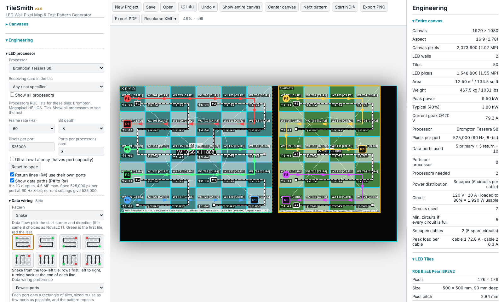
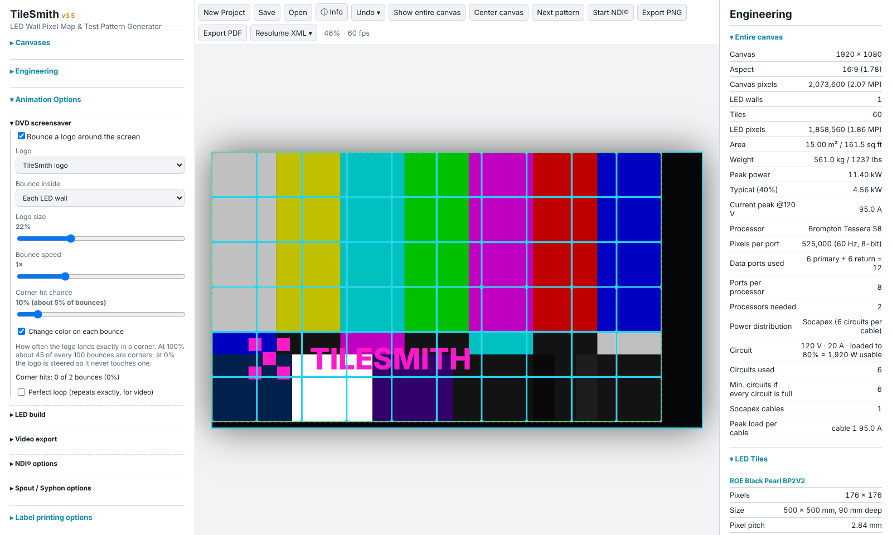
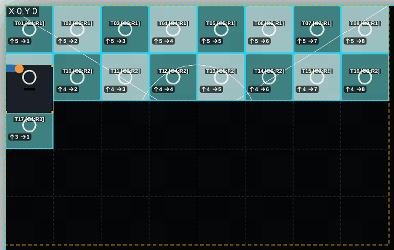

# TileSmith

**[TLDR I just want to download it](#download)**

Pre production software for LED walls. Engineering specs, cable labels, pixel maps and test patterns with some fun animation for vidiots. Yes it is vibe coded.

## Videos

> **Note:** these videos show a very early version of TileSmith. The app has changed a lot since they were filmed.

<table>
<tr>
<td width="33%" valign="top">

https://github.com/user-attachments/assets/ad490931-0c5d-47d6-92ca-d4c2faeee1d6

<b>On site, building a real wall</b> The build animation running on an LED wall in an arena while the crew builds it, tile by tile.

</td>
<td width="33%" valign="top">

https://github.com/user-attachments/assets/ccb46ffc-e185-4ef4-a353-455af979b058

<b>LED build animation</b> A tech carries tiles into place and the wall fills in, row by row, on a laptop.

</td>
<td width="33%" valign="top">

https://github.com/user-attachments/assets/3fe2f407-80e1-4f42-a2f5-a2593f6d69d9

<b>Test pattern in an arena</b> A TileSmith test pattern on the side screens of an arena during setup.

</td>
</tr>
</table>

## Screenshots

**Data and power wiring.** Two walls on a Brompton Tessera S8, with data paths (P# to R#) and power circuits drawn on the tiles, and the engineering figures on the right.

**DVD screensaver over SMPTE bars.** The TileSmith logo bounces around each wall on top of the SMPTEbars test pattern.

**LED build animation.** The wall is half built and a tech is carrying the next tile into place on the third row.

The screenshots are made from the app itself with `manual-src/make_readme_shots.py`.

## Virus scan and documentation

**Virus scan:** every program file in each release is scanned on VirusTotal after it is built. See the results, with a link to each full report and the SHA-256 of every file, in **[VIRUSTOTAL.md](VIRUSTOTAL.md)**.

**Documentation** (always the latest release):

- [TileSmith-Manual.pdf](https://github.com/kingof9x/TileSmith/releases/latest/download/TileSmith-Manual.pdf): user manual for the desktop app (Windows, Mac, Linux)
- [TileSmith-Mobile-Manual.pdf](https://github.com/kingof9x/TileSmith/releases/latest/download/TileSmith-Mobile-Manual.pdf): manual for the Android and iOS app
- [TileSmith-App-Spec.md](https://github.com/kingof9x/TileSmith/releases/latest/download/TileSmith-App-Spec.md): full written specification of the app, for developers

## Disclaimer & Limitation of Liability

**USE AT YOUR OWN RISK.** This software is provided "AS IS", without warranty of any kind, express or implied, including but not limited to the warranties of merchantability, fitness for a particular purpose, and noninfringement. 

* **Production & Platform Status:** Currently, only the Windows version has been tested and deployed in live production environments. Other platforms remain experimental.
* **Independent Verification:** All engineering outputs, calculations, and operational information generated by this program are for reference only and must be verified independently by qualified personnel prior to use in any critical, live-event, or production workflow.
* **Assumption of Risk:** The authors, contributors, and copyright holders shall not be held liable for any direct, indirect, incidental, special, exemplary, or consequential damages (including, but not limited to, procurement of substitute goods or services; loss of use, data, or profits; or business interruption) however caused and on any theory of liability arising in any way out of the use of this software, even if advised of the possibility of such damage. You assume all responsibility, risk, and liability associated with the operation of this program and the information it produces. 

Concept and development: Callum Davenport-Lambton · tilesmithapp@gmail.com · https://ko-fi.com/kingof9x

## Software to install before you use a downloaded build

The downloads on the **Releases** page do not contain the NDI® runtime or ffmpeg (their licences do not allow it), so these two
features need a free install on the computer that runs TileSmith. Everything else works straight away. **Spout and Syphon are
included in the Windows and Mac downloads, so they need nothing extra** (their licences are in `tilesmith-desktop/bin`).

| Feature | Windows | Mac | Linux |
|---|---|---|---|
| Test patterns, wiring, labels, exports, animation | Nothing to install | Nothing to install | Nothing to install |
| **NDI® output** (needs this install) | NDI® Runtime: <https://ndi.link/NDIRedistV6> or the free NDI® Tools: <https://ndi.video/tools/> | NDI® Runtime for Mac: <https://ndi.link/NDIRedistV6Apple> or NDI® Tools: <https://ndi.video/tools/> | NDI® Runtime (`libndi.so.6`): get "NDI SDK for Linux" or the Linux tools from <https://ndi.video/for-developers/ndi-sdk/> and copy `libndi.so.6` to `/usr/local/lib` (then run `sudo ldconfig`), or point `NDI_RUNTIME_DIR_V6` at its folder |
| **Spout output** | Included. Needs a DirectX 11 graphics card. Pick the card under *Spout options* if the picture is black | not applicable | not applicable |
| **Syphon output** | not applicable | Included | not applicable |
| **Video export** (needs this install) | An ffmpeg "full" build with the HAP encoder: <https://www.gyan.dev/ffmpeg/builds/> (`ffmpeg-release-full`). Unzip it and put `ffmpeg.exe` in the same folder as `TileSmith-Portable.exe` | `brew install ffmpeg` (Homebrew: <https://brew.sh/>). For HAP video see step 5 in `tilesmith-desktop/BUILD-MAC.txt` | `sudo apt install ffmpeg` (Debian, Ubuntu), `sudo dnf install ffmpeg` (Fedora, needs RPM Fusion), `sudo pacman -S ffmpeg` (Arch). HAP video needs an ffmpeg built with the HAP encoder; otherwise use the MP4 formats. You can also set `TILESMITH_FFMPEG` to your ffmpeg path |

You also need a program to receive the picture, for example Resolume, vMix, OBS, MadMapper or TouchDesigner.
If NDI® or video export is not set up, TileSmith shows a message saying what is missing; nothing else is affected.
The Mac and Windows apps are unsigned: on Windows click *More info > Run anyway*; on a Mac right-click the app and choose *Open*.

NDI® is a registered trademark of Vizrt NDI AB. Learn more about NDI® at <https://ndi.video/>.

## Download

Get the latest build from the **[Releases page](https://github.com/kingof9x/TileSmith/releases/latest)**, or use the direct links
below (they always point at the newest release). The builds are unsigned, and NDI® output and video export need the free
software listed in *Software to install* above.

| Platform | File | What it is |
|---|---|---|
| **Windows** 10/11, 64-bit | [TileSmith-windows-portable.exe](https://github.com/kingof9x/TileSmith/releases/latest/download/TileSmith-windows-portable.exe) | Portable app: no install, just run it. Includes Spout. |
| **Mac** (Apple Silicon and Intel) | [TileSmith-mac-universal.dmg](https://github.com/kingof9x/TileSmith/releases/latest/download/TileSmith-mac-universal.dmg) | Open it and drag TileSmith to Applications. Includes Syphon. Right-click the app and choose *Open* the first time. |
| **Linux**, any distribution | [TileSmith-linux-x64.AppImage](https://github.com/kingof9x/TileSmith/releases/latest/download/TileSmith-linux-x64.AppImage) | Runs without installing: make it executable, then run it. |
| **Debian, Ubuntu, Mint** | [TileSmith-linux-x64.deb](https://github.com/kingof9x/TileSmith/releases/latest/download/TileSmith-linux-x64.deb) | `sudo apt install ./TileSmith-linux-x64.deb` |
| **Fedora, RHEL, openSUSE** | [TileSmith-linux-x64.rpm](https://github.com/kingof9x/TileSmith/releases/latest/download/TileSmith-linux-x64.rpm) | `sudo dnf install ./TileSmith-linux-x64.rpm` |
| **Arch, Manjaro** | [TileSmith-linux-x64.pacman](https://github.com/kingof9x/TileSmith/releases/latest/download/TileSmith-linux-x64.pacman) | `sudo pacman -U TileSmith-linux-x64.pacman` |
| **Linux (Snap)** | [TileSmith-linux-x64.snap](https://github.com/kingof9x/TileSmith/releases/latest/download/TileSmith-linux-x64.snap) | `sudo snap install --dangerous TileSmith-linux-x64.snap` |
| **Linux (Flatpak)** | [TileSmith-linux-x64.flatpak](https://github.com/kingof9x/TileSmith/releases/latest/download/TileSmith-linux-x64.flatpak) | `flatpak install --user TileSmith-linux-x64.flatpak` |
| **Android** 7.0 or newer (phone, tablet or emulator) | [TileSmith-android.apk](https://github.com/kingof9x/TileSmith/releases/latest/download/TileSmith-android.apk) | Test build. Copy it to the device, tap it and allow *Install unknown apps*; or on a computer run `adb install TileSmith-android.apk`. Debug-signed, so not for Google Play. |
| **All platforms** | [TileSmith-Manual.pdf](https://github.com/kingof9x/TileSmith/releases/latest/download/TileSmith-Manual.pdf) | User manual for the desktop app. |
| **Android / iOS** manual | [TileSmith-Mobile-Manual.pdf](https://github.com/kingof9x/TileSmith/releases/latest/download/TileSmith-Mobile-Manual.pdf) | Manual for the phone and tablet app (the iPhone/iPad app has to be built on a Mac with Xcode: see `BUILD-IOS.txt`). |
| **Developers** | [TileSmith-App-Spec.md](https://github.com/kingof9x/TileSmith/releases/latest/download/TileSmith-App-Spec.md) | Full written specification of the app. |

On Ubuntu 24.04 and newer the AppImage may need `--no-sandbox`; installing the `.deb` avoids that.

After every release the files are scanned on VirusTotal and the results are written to [VIRUSTOTAL.md](VIRUSTOTAL.md) in the root of this repository, with the SHA-256 of each file so you can check your download.

## What is in this repository

| Folder or file | What it is |
|---|---|
| `tilesmith-desktop/app/index.html` | The whole app in one page (HTML, CSS, JavaScript). Every build uses this same page. |
| `tilesmith-desktop/` | The Windows and Mac desktop app (Electron): `main.js`, `package.json`, `scripts/`, `build/` icons, `bin/` (Spout and Syphon). |
| `tilesmith-desktop/mobile/` | The Android and iOS app (Capacitor 8). |
| `tilesmith-desktop/android-aistudio/` | The Android app as Kotlin + Jetpack Compose (for Google AI Studio or Android Studio). |
| `tilesmith-desktop/BUILD-*.txt` | Step-by-step build guides: Windows, Mac, Android, iOS. |
| `tilesmith-desktop/TileSmith-Manual.pdf` | User manual (desktop). |
| `tilesmith-desktop/TileSmith-Mobile-Manual.pdf` | User manual (Android and iOS). |
| `tilesmith-desktop/TileSmith-App-Spec.md` | Full specification of the app, for rebuilding it elsewhere. |
| `manual-src/` | The tools that make the manuals, the spec, the Google AI Studio kit and the version bump, plus their tests. `WORKFLOW.md` explains how a release is put together. |

## Building

Read the guide for your platform in `tilesmith-desktop/`. In short:

- **Windows**: Node.js LTS, plus the NDI® SDK and an ffmpeg "full" build on the build computer. Then, in Command Prompt
  in `tilesmith-desktop`: `npm run clean`, `npm install`, `npm run dist`. The result is `TileSmith-Portable.exe`.
- **Mac**: Node.js, the NDI® SDK and ffmpeg (BUILD-MAC.txt explains each), then `npm run dist:mac`. The result is a
  universal `.dmg`.
- **Android / iOS**: `npm install`, then `npm run android` or `npm run ios` in `tilesmith-desktop/mobile`, then Android
  Studio or Xcode.

Not stored here (each build computer adds them, as the guides explain):

- ffmpeg;
- the NDI® runtime;
- `node_modules`;
- build output: `dist/`, `.exe`, `.dmg`, APKs.

Spout (`bin/spout`) and Syphon (`bin/mac/syphon`) are included, with their licences.

On a Mac, clone the repository rather than downloading a ZIP. `Syphon.framework` contains symbolic links that a clone
keeps.

## Licence and third-party notices

No licence has been chosen yet, so all rights are reserved. This repository is private.

- **Spout** SDK (SpoutDX.dll) by Lynn Jarvis, https://spout.zeal.co/, Simplified BSD licence (`bin/spout/Spout-licence.txt`).
- **Syphon** framework, BSD licence; **node-syphon**, MIT licence (`bin/mac/syphon/`).
- **NDI®** is a registered trademark of Vizrt NDI AB, https://ndi.video/. The NDI® runtime is not stored here. Builds take
  it from the NDI® SDK under the NDI® SDK License Agreement (https://ndi.link/ndisdk_license). NDI® Tools:
  https://ndi.video/tools/.
- The built-in disguise test-pattern images and ffmpeg need checking before any public release.

## Licence

Copyright (c) 2026 Callum Davenport-Lambton.

- **Program code:** GNU General Public License v3 or later, see [`LICENSE`](LICENSE).
- **Animated technician** (character design, artwork, animations, the TileSmith name and logo): all rights reserved,
  not GPL. See [`tilesmith-desktop/COPYRIGHT-AND-ARTWORK.txt`](tilesmith-desktop/COPYRIGHT-AND-ARTWORK.txt).
- **Third parties** (NDI runtime, Spout, Syphon, ffmpeg, npm packages) keep their own licences, listed in the same file.

## Downloads and builds

Open **Actions > Build and release > Run workflow**, type a version such as `3.3` and run it. GitHub builds the Windows portable
app, the Mac universal installer and an Android APK, and the Linux packages (`.AppImage`, `.deb`, `.rpm`, `.pacman` for Arch, `.snap` and `.flatpak`;
no Spout or Syphon there; NDI® needs the runtime installed), and attaches them to a release named `v3.3` together with the manuals. Downloads are on the **Releases** page. The builds are unsigned. On Ubuntu
24.04 and newer, the AppImage may need `--no-sandbox` (or install the `.deb`).

## Project status

**Status:** Waiting on testing and data from a live system
**Waiting on:** Callum (testing NovaStar export; getting Brompton project data from a working system with live tiles)
**Last updated:** 2026-10-27

### Task list

- [ ] Review and merge PR #4 (Hide/Show Engineering Data button on the far right of the toolbar)
- [ ] Test NovaStar `.scr` file export
- [ ] Get Brompton project files and data from a working system with live tiles
- [ ] Resume reverse engineering Brompton project files once that data is in hand (blocked on the item above)

